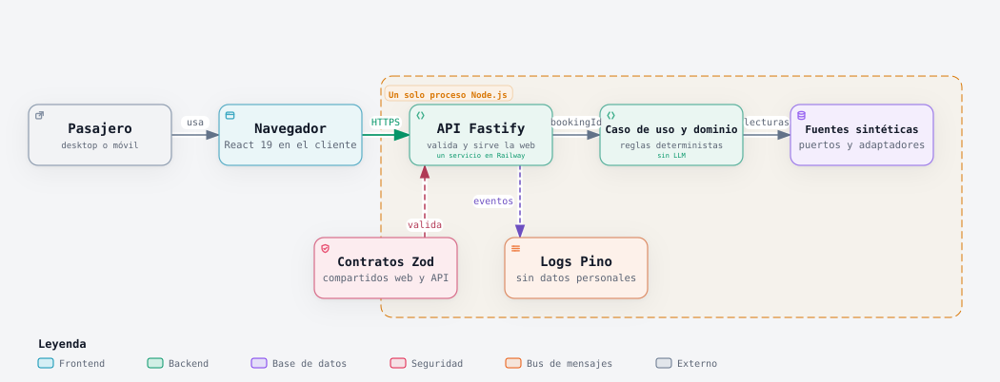

# FlyNext

*Your journey. Your next step.* — **FlyNext es un demo.** Demostración independiente (Caso A, acompañante de disrupciones), no un producto oficial de ninguna aerolínea; datos 100 % sintéticos. [Repositorio](https://github.com/fmurillodev/fly-next) · [Aplicación](https://flynext-api-production.up.railway.app) · [Swagger](https://flynext-api-production.up.railway.app/docs)

## 1. Problema, resultado y alcance

Ante un retraso, el pasajero recibe datos que no coinciden y no sabe qué es seguro y qué es estimación. FlyNext reúne reserva, eventos, políticas y alternativas y devuelve una **evaluación verificable**: qué pasó, qué se sabe y qué no, riesgo de la conexión y qué se recomienda. Objetivo: reducir la incertidumbre (impacto no medido). **Nunca presenta una recomendación como acción ejecutada.**

**Track Backend/Integración:** el reto es convertir información incompleta y contradictoria en decisiones seguras, y eso ocurre en el servidor; React es una capa complementaria sin reglas de negocio. **Implementado:** `POST /api/v1/disruptions/assessment`, motor de decisiones, interfaz responsive, despliegue único. **No implementado:** escrituras (rebooking, compensaciones), LLM, autenticación, sistemas reales, base de datos. **Supuestos** sin validar: umbral de 30 min, frescura 5/30/15 min, jerarquía de fuentes, grupo unido.

## 2. Arquitectura

React corre en el navegador; Fastify entrega la web compilada y la API desde un solo proceso. [Versión completa y más diagramas](docs/diagrams/README.md).

## 3. Decisiones y alternativas

*Tomadas de exclusiones explícitas de la especificación; repos y servicios separados no tuvieron evaluación formal.*

| Decisión | Alternativa no elegida | Trade-off aceptado |
| --- | --- | --- |
| Motor determinista | LLM en ejecución | Menos flexible con lenguaje natural; reproducible y sin políticas inventadas |
| Ports & Adapters pragmático | Arquitectura distribuida | Más estructura que un script; dominio probado sin HTTP |
| Monorepo pnpm, contratos Zod compartidos | Repos separados, esquemas duplicados | Acopla apps a un paquete; evita contratos divergentes |
| Fuentes sintéticas, evaluación stateless | Sistemas reales, base de datos | Sin integración real ni historial; demo pública sin datos personales |
| Un servicio Railway, Fetch API | Despliegues separados, Axios | Web y API escalan juntas; sin reintentos |
| Revisión humana recomendada | Ejecución automática | Más lento; ninguna acción sensible sin una persona |

## 4. Clasificación de decisiones

| Paso | Clasificación | Razón | Riesgo | Control / fallback |
| --- | --- | --- | --- | --- |
| Validación, fuentes y frescura | Determinístico (implementado) | Reglas exactas; autoridad por dato | Entrada abusiva; supuestos sin validar | Zod, 1 KB, límite de ritmo; incertidumbre explícita |
| Conexión | Determinístico (implementado) | `MISSED` exige confirmación | Declarar sin evidencia | `UNKNOWN`; sin MCT inventado |
| Políticas, alternativas, recomendaciones y mensajes | Determinístico (implementado) | Reglas R1–R5 y plantillas desde hechos | Prometer un beneficio o sugerir acción hecha | "Aplicable" ≠ ejecutado; `actions.executed` vacío |
| Consultas ambiguas | AI-assisted (propuesto) | Lenguaje natural | Intención mal entendida | Salida validada; decide el motor |
| Orquestación de herramientas | Agentic (propuesto) | Consultas compuestas | Llamadas fuera de alcance | Solo lectura, allowlist, límites |
| Acciones sensibles | Human-controlled (ejecución no implementada) | Impacto económico | Acción errónea o duplicada | Autorización e idempotencia (futuro) |

No hay LLM en ejecución. La revisión humana es una recomendación, no un escalamiento ejecutado; no hay rebooking real. Diseño futuro: [AI Usage](docs/AI-USAGE.md).

## 5. Ejecución y validación

Node 24.15.0 y pnpm 12.16.1: `pnpm install --frozen-lockfile`, `pnpm dev`, `pnpm test`, `pnpm build`, `pnpm start` (puerto 3000); `curl` en la [evidencia técnica](docs/TECHNICAL-EVIDENCE.md). Reservas públicas: **ABC123** (conexión en riesgo, `HUMAN_REVIEW`), **DEMO01** (sin disrupción), **DEMO02** (190 min, R1 aplicable). **Validación:** 340 tests (50 contratos, 280 API, 10 frontend), CI en cada pull request, humo público y capturas a 375 y 1440 px.

## 6. Riesgos y próximos pasos

**Riesgos:** reglas sin validar; límite de ritmo sin aislamiento por cliente demostrado; sin `X-Request-Id` en el 404 genérico; revisión nativa parcial; tests de interfaz posteriores al código; sin auditoría de accesibilidad ni pruebas de carga; tiempo activo no medido.
**Próximos pasos:** 1. validar umbrales y fuentes; 2. autenticación sobre reservas reales; 3. correlación global y límite por cliente; 4. accesibilidad y carga; 5. piloto AI-assisted de solo lectura.

**Más:** [Evidencia técnica](docs/TECHNICAL-EVIDENCE.md) · [AI Usage](docs/AI-USAGE.md) · [Demostración](docs/DEMO.md) · [Diagramas](docs/diagrams/README.md) · [Ingeniería](docs/engineering/ARCHITECTURE.md) · [Registro de IA](docs/evidence/AI-DECISION-LOG.md)
