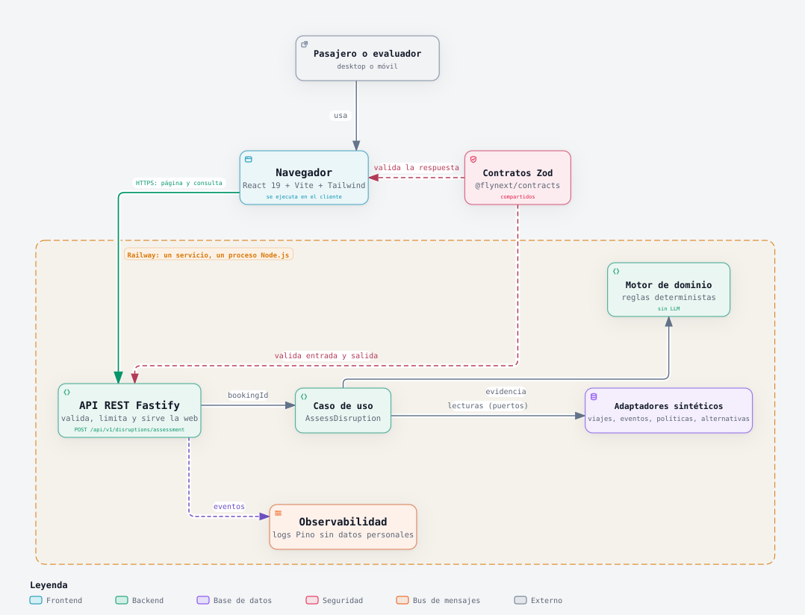
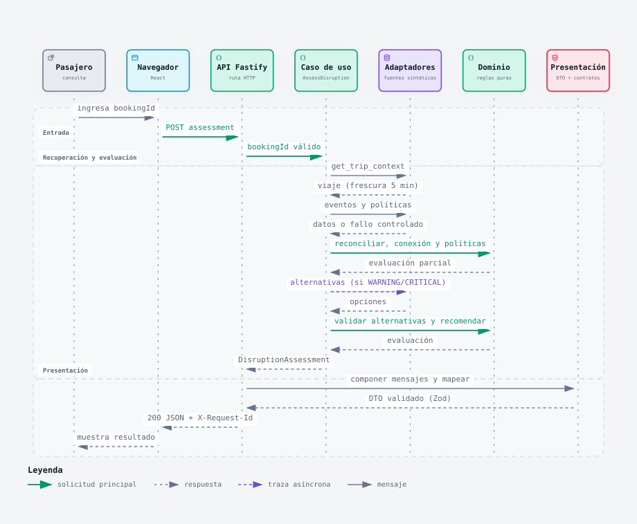
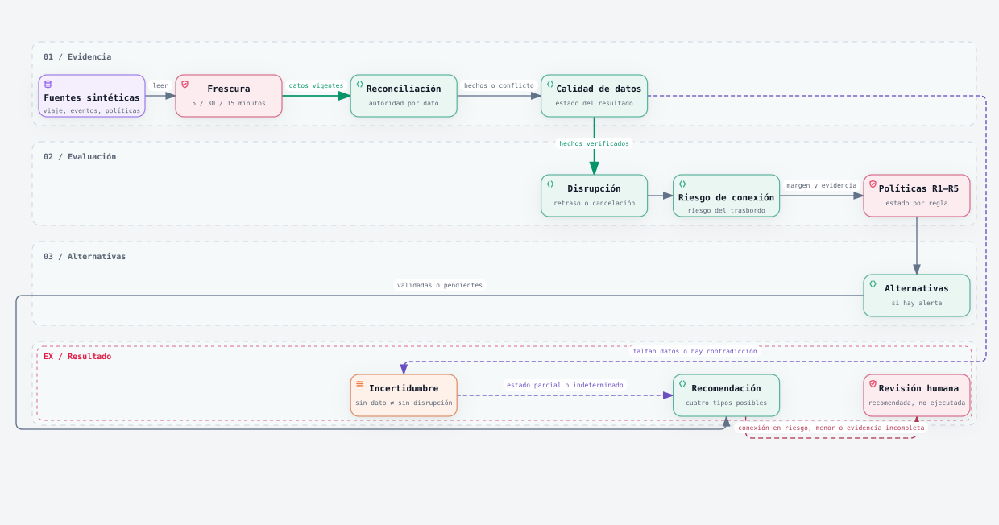
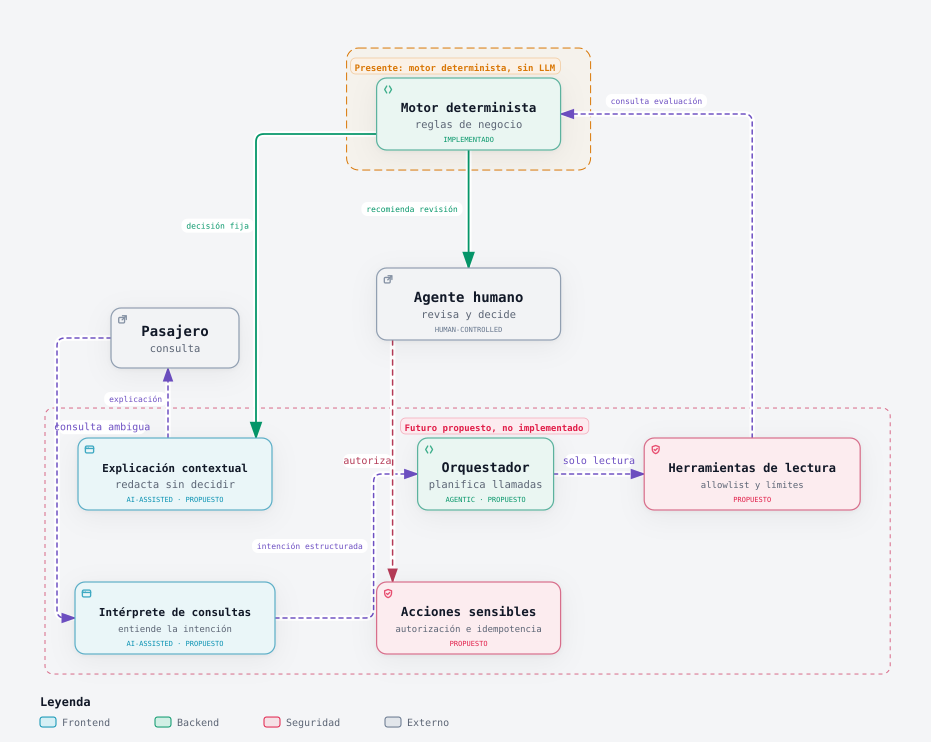

# FlyNext — Galería de diagramas

FlyNext es un demo. Los cuatro diagramas se basan en el código real (`apps/api`, `apps/web`, `packages/contracts`). Los HTML interactivos también se pueden abrir en línea desde la [galería interactiva](https://fmurillodev.github.io/fly-next/). Cada uno tiene una imagen SVG que GitHub muestra directamente, una versión HTML interactiva para explorar en local y su fuente regenerable.

| # | Diagrama | SVG | HTML (local) | Fuente |
| --- | --- | --- | --- | --- |
| 1 | Arquitectura del sistema | [svg](svg/01-arquitectura.svg) | [html](html/01-arquitectura.html) | [json](source/01-arquitectura.architecture.json) |
| 2 | Secuencia de evaluación | [svg](svg/02-secuencia.svg) | [html](html/02-secuencia.html) | [json](source/02-secuencia.sequence.json) |
| 3 | Flujo de decisiones | [svg](svg/03-decisiones.svg) | [html](html/03-decisiones.html) | [json](source/03-decisiones.workflow.json) |
| 4 | Límites de IA y decisiones | [svg](svg/04-limites-ia.svg) | [html](html/04-limites-ia.html) | [json](source/04-limites-ia.architecture.json) |

La versión compacta del diagrama 1 que usa el [README](../../README.md) es [`svg/01-arquitectura-compacta.svg`](svg/01-arquitectura-compacta.svg) (fuente en `source/`).

## 1. Arquitectura del sistema



El pasajero usa un navegador, donde se ejecuta React (Vite y Tailwind). La consulta viaja por HTTPS a un único servicio en Railway: la API REST Fastify, que además entrega los archivos estáticos de la web. Fastify valida la entrada, invoca el caso de uso `AssessDisruption`, que lee las fuentes sintéticas mediante puertos y delega las reglas al motor de dominio. Los contratos Zod se comparten entre API y web, y Pino registra eventos sin datos personales. React no es un proceso servidor independiente.

## 2. Secuencia de evaluación



Orden real del código: la ruta valida la solicitud (tipo de contenido, tamaño, límite de solicitudes y esquema); el caso de uso lee primero el viaje y comprueba su frescura; luego lee eventos y políticas en paralelo; el dominio reconcilia las fuentes, clasifica la disrupción, evalúa la conexión y aplica las políticas; solo si hay alerta o severidad crítica se leen y validan las alternativas; por último se decide la recomendación. La capa de presentación compone los mensajes y mapea el DTO por lista de permitidos, la ruta valida la respuesta con el contrato y recién entonces la devuelve.

## 3. Flujo de decisiones



Las fuentes se validan por frescura y se reconcilian según su autoridad por tipo de dato. Si faltan datos o hay una contradicción sin resolver, el resultado declara incertidumbre (`PARTIAL` o `INDETERMINATE`) en vez de asumir que no hay disrupción. Con datos verificados se clasifica la disrupción, se evalúa el riesgo de conexión (sin Minimum Connection Time inventado), se aplican las políticas R1–R5 y se evalúan alternativas. La recomendación puede indicar revisión humana, pero eso es una recomendación: el sistema no la ejecuta.

## 4. Límites de IA y decisiones



Lo **implementado** es el motor determinista y la recomendación de revisión humana. Todo lo marcado como **propuesto** (intérprete de consultas, orquestador, herramientas de lectura, explicación contextual y acciones sensibles) es diseño futuro y no forma parte del runtime actual. En ese diseño la IA interpreta y explica, pero no inventa políticas, beneficios, horarios ni disponibilidad; el motor conserva la autoridad; las herramientas son de solo lectura con allowlist y límites; y las acciones sensibles exigen autorización, idempotencia y reconciliación.

### Ejemplo del diseño futuro

Consulta: "Mi primer vuelo se atrasó, ¿llego a mi conexión y qué otra opción tengo?" Un intérprete identificaría la intención (riesgo de conexión más alternativas) y la dividiría en dos preguntas; un orquestador recuperaría el contexto de la reserva y llamaría solo a las herramientas de lectura permitidas, que consultan el mismo motor; se validaría la evidencia recibida; el motor aplicaría las reglas (`AT_RISK`, alternativa pendiente de validación) y la explicación contextual las redactaría sin añadir datos; por último, se recomendaría una revisión humana. Nada de esto está implementado.

## Cómo se generaron

Herramienta: [Archify](https://github.com/tt-a1i/archify) 3.3.2 (Apache-2.0), instalada a nivel de proyecto con `npx skills add https://archify.si --skill archify --agent codex --copy` y ejecutada localmente; no es dependencia del producto ni se versiona (`.agents/` está ignorado). Ningún dato del repositorio se envió a servicios externos. Para regenerar con Archify instalado:

```bash
node .agents/skills/archify/bin/archify.mjs finalize architecture docs/diagrams/source/01-arquitectura.architecture.json docs/diagrams/html/01-arquitectura.html --quality showcase
node .agents/skills/archify/bin/archify.mjs export-svg architecture docs/diagrams/source/01-arquitectura.architecture.json docs/diagrams/svg/01-arquitectura --theme light
```

Los HTML interactivos se publican con GitHub Pages en la [galería interactiva](https://fmurillodev.github.io/fly-next/); GitHub no los ejecuta dentro del repositorio, por eso el SVG es la vista principal en GitHub. El tipo de diagrama de cada fuente está en su nombre (`architecture`, `sequence`, `workflow`).
